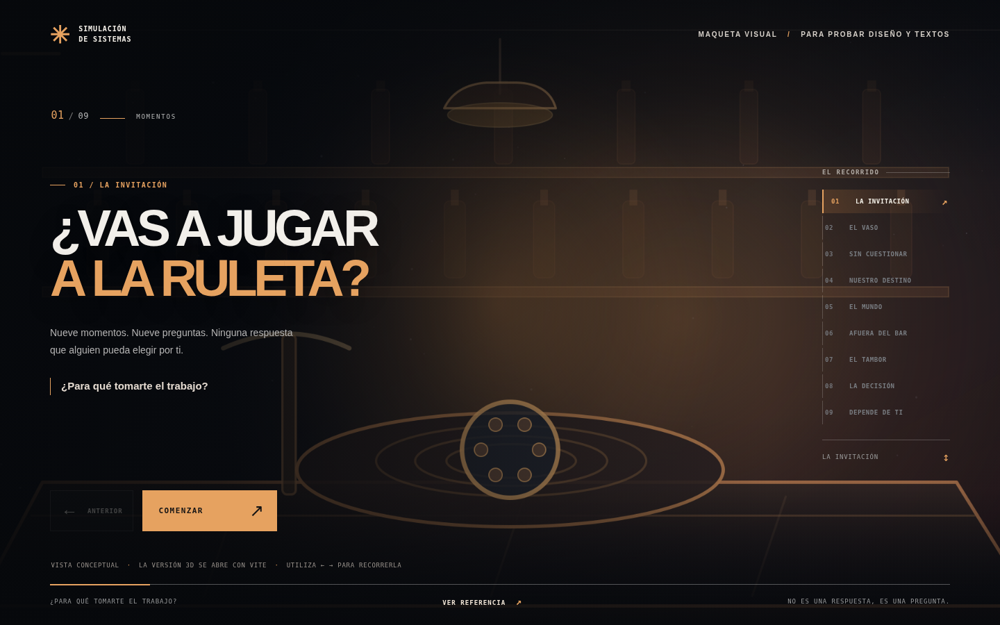

# Unidad 8 — Why Bother? ¿Para qué tomarte el trabajo?

Una **primera versión jugable de la obra**: nueve escenas 3D sencillas, una experiencia narrativa guiada por preguntas y una simulación de partículas que se dispersan y encuentran otra forma. Está hecha con **Three.js + Vite**, sin modelos 3D descargados. Las figuras, el bar, la ciudad, la Tierra y los objetos se construyen con geometrías de Three.js.

> **Intención:** la metáfora de la ruleta pregunta quién toma las decisiones cuando hay inteligencia artificial, presión social y resultados inmediatos. No se pretende dar una respuesta definitiva. El desenlace es abstracto y no muestra lesiones.

## Dos formas de revisarlo

- **`Vista_previa.html`**: ábrelo con doble clic y recorre las nueve escenas como **maqueta visual**. Usa las imágenes del storyboard, no renders 3D. No necesita instalar nada.
- **`index.html` con Vite**: la versión **3D real**, con modelos, animaciones y partículas. Requiere ejecutar el servidor de desarrollo como se indica abajo.



## Cómo abrirlo en tu computador

1. Instala Node.js 20 o posterior (tu versión 20.15 también es compatible con Vite 6).
2. Abre la carpeta `Unidad8_WhyBother` en Visual Studio Code.
3. Abre una terminal **dentro de esa carpeta**.
4. Ejecuta:

```bash
npm install
npm run dev
```

5. Abre la dirección local que aparece, normalmente `http://localhost:5173`.

**Nota:** abrir `index.html` con doble clic no ejecuta correctamente Vite. Hay que utilizar el servidor de desarrollo con `npm run dev`.

## Interacciones

- **COMENZAR / CONTINUAR:** avanzar entre los nueve momentos.
- **ANTERIOR:** regresar.
- **Números 1 a 9:** saltar directamente a una escena.
- **Flechas izquierda y derecha:** cambiar de escena.
- **Menú de escenas a la derecha** (o números en móvil): saltar a cualquier momento.
- **VER REFERENCIA:** mostrar la ilustración original del storyboard y la técnica de esa escena.
- **SONIDO:** activar pequeños pulsos sonoros, desactivados por defecto.
- **Mover el mouse:** una pequeña variación de cámara para dar profundidad.

## Estructura

```
Unidad8_WhyBother/
├── index.html
├── package.json
├── vite.config.js
├── StoryBoard.md
├── README.md
├── src/
│   ├── main.js           # textos, navegación y controles
│   ├── experience.js     # modelos y animaciones Three.js
│   └── style.css         # diseño visual y responsive
├── public/
│   └── referencias/      # imágenes del storyboard original
└── .github/workflows/
    └── deploy.yml        # despliegue automático de GitHub Pages
```

## Qué cambiaremos cuando revisemos la primera versión

- Elegir encuadres precisos para cada objeto y cuánta información se ve en cada escena.
- Mejorar las animaciones de la persona (por ahora es una figura geométrica básica).
- Ajustar el ritmo de lectura, los contrastes y los movimientos de cámara.
- Refinar el escenario del bar y la transición al exterior.
- Decidir si el desenlace necesita una elección interactiva de la audiencia.
- Afinar la simulación de partículas para que represente mejor la recuperación de la autonomía.

## Publicarlo en GitHub Pages

El workflow está en `.github/workflows/deploy.yml`. Sube **el contenido de esta carpeta a la raíz del repositorio**, en la rama `main`. En GitHub ve a **Settings → Pages → Build and deployment → Source: GitHub Actions**. Cada `push` a `main` compilará `dist` y publicará la página.

El `base: './'` del `vite.config.js` evita tener que poner a mano el nombre del repositorio.

**Si colocas el proyecto dentro de una subcarpeta** (por ejemplo `unidad8_`), el workflow incluido debe ajustarse a ese directorio para `npm install`, `npm run build` y `dist`.

## Sobre la implementación

- El tablero conceptual original está conservado en `StoryBoard.md` y en `public/referencias`.
- Los modelos y animaciones no contienen recursos de pago, música protegida ni modelos externos.
- La Tierra utiliza una textura procedimental sencilla dibujada mediante Canvas; no es una textura cartográfica precisa.
- El final usa **agentes con posición, objetivo, velocidad, atracción y amortiguación**, una forma simple de *steering* para dispersarse y reorganizarse. Esta es la simulación central de la experiencia.
- La representación del arma es una silueta estilizada, concebida solo como un símbolo en una obra de ficción.
